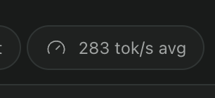

# paseo-tps



Shows how fast the model is generating, in tokens per second, as a composer pill next to Tasks and
Subagents. Pressing the pill opens the details: current value, turn average, thinking and answer rates,
how long the model has actually been generating, and the chars-per-token factors the estimate is using.

## What the number means

**Speed is measured per generation second, not per second of wall clock.** A pi turn that runs a shell
command spends most of its wall clock waiting for the shell, so an average over wall clock reports a fast
model as slow. The engine runs a separate clock that only advances while the model is the thing being
waited on:

- it starts at the first streamed delta of a step and stops a short grace period after the last one;
- a tool call cuts it short at the moment the tool started, but only when that start came after the most
  recent delta (the daemon emits the tool-call item before the rest of a step's text);
- while the clock is stopped the pill holds its most recent value instead of decaying.

So `120 tok/s` means the model produced tokens at 120 per second while it was generating, and the time a
shell command took is excluded rather than averaged in. The popover shows both figures.

**Tokens are estimated, and the `~` says so.** Providers report token counts at step boundaries, not per
chunk, and on a plain generation turn pi reports nothing until the turn ends. While generating, the rate is
therefore characters divided by a chars-per-token factor, anchored on the last reported token count. Every
live value carries the `~`; the turn average drops it because that one is measured.

**The factor is learned.** Characters per token depends on what the model is doing: measured on
pi/deepseek-flash, answer text ran at 4.3-4.9 chars/token while reasoning text ran at 2.2-2.4. Each
finished turn measures the real ratio, so the plugin fits thinking and answer factors separately per
provider and model, blended towards conservative seeds while the history is thin. Tool-heavy turns are
excluded from the fit because they stream almost no text while producing many tokens.

## Limits

- Factors are learned in memory, so they reset when the plugin reloads. Four to ten real turns is enough to
  move them off the seeds.
- A turn whose model produced only tool-call arguments and no streamed text has no observable generation
  window, so its average is unknown rather than a wall-clock guess.
- Verified against `pi/deepseek/deepseek-flash`. Other providers are expected to work (the accounting rule
  is provider-agnostic and handles per-request counters that reset mid-turn) but are untested.

## Development

```bash
npm install
npm test          # 55 tests, including replays of recorded real turns
npm run typecheck
paseo plugin reload paseo-tps
```

`tests/fixtures/runs.ts` is generated from real recorded turns by `.spike/make-fixtures.mjs`; the spike
harness and the raw runs live in `.spike/` (dev only, never imported by the plugin).
